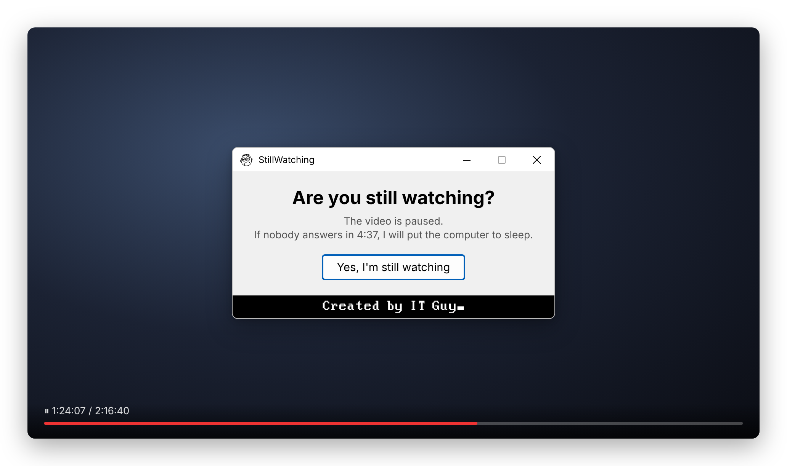
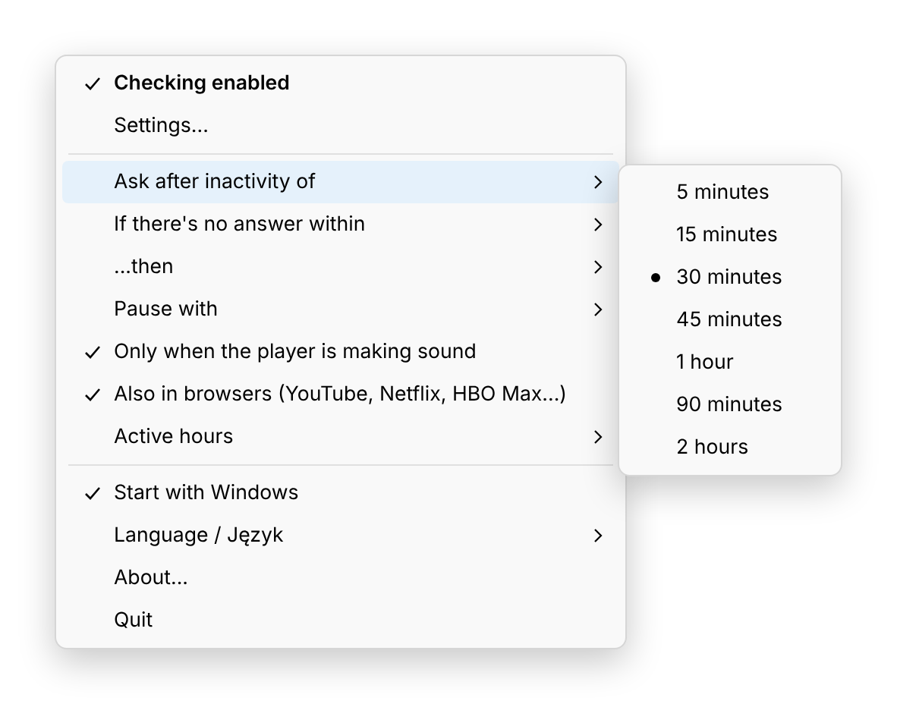
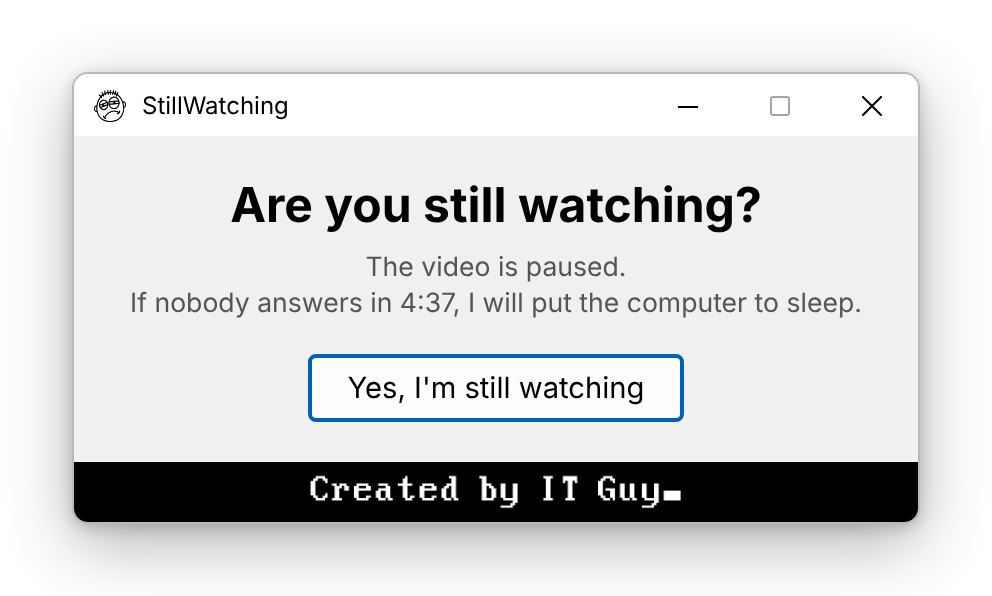
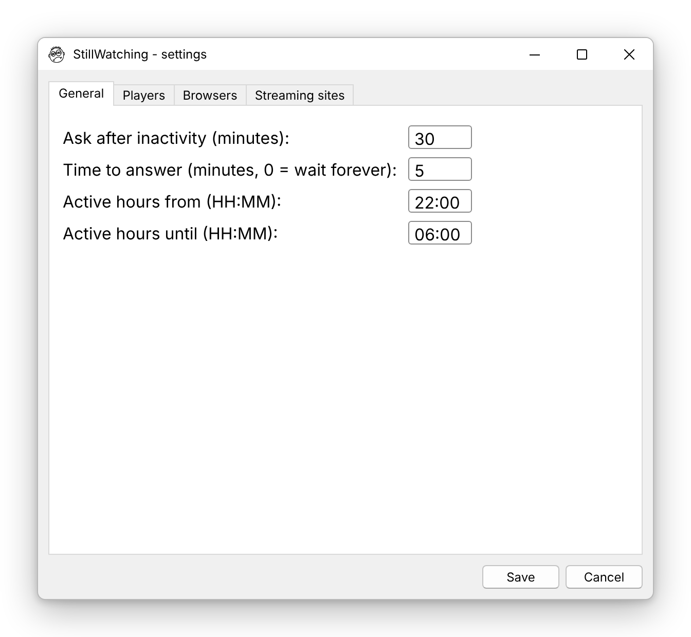
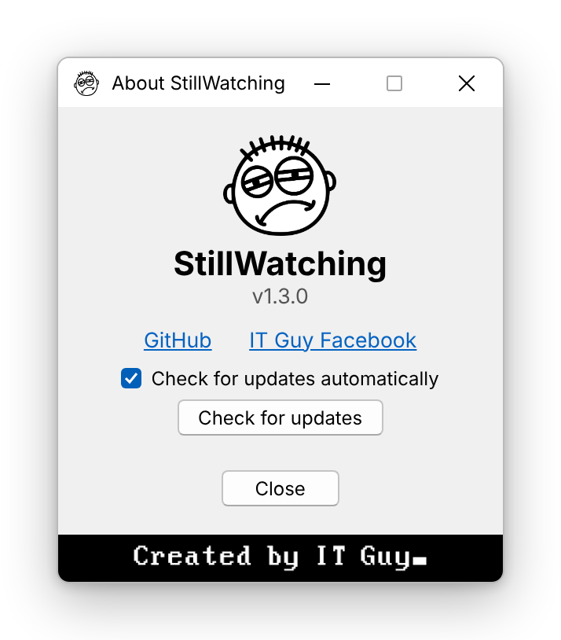
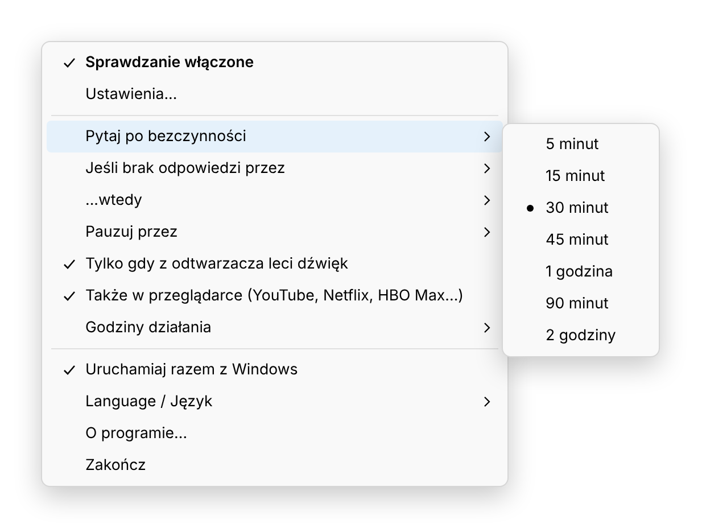
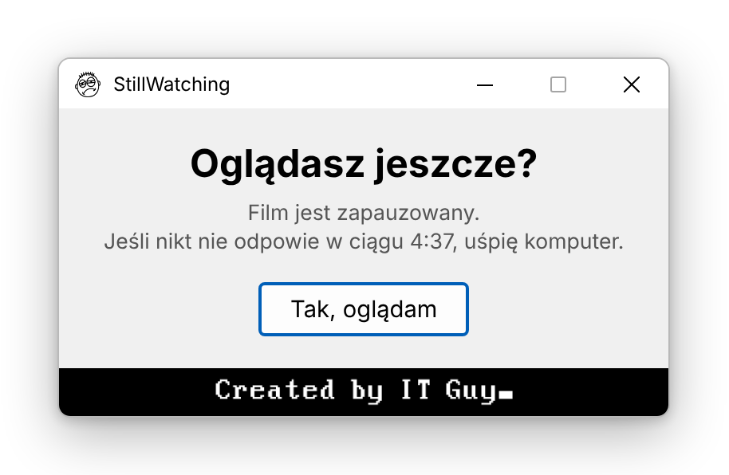
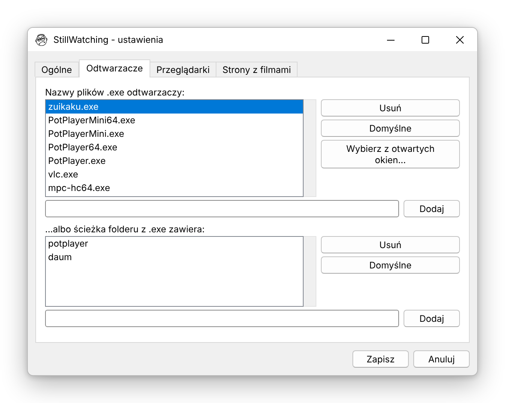

# StillWatching 👁️

**"Are you still watching?" — the Netflix question, for every video player on Windows.**

Fell asleep during a movie again? StillWatching sits quietly in the system tray. When a video
is playing and nobody has touched the mouse or keyboard for a while, it pauses the video and
asks if you're still there. No answer? It can leave the video paused, close the player, put
the PC to sleep, hibernate or shut it down — so you don't wake up at 4 a.m. to episode 9 and a
hot laptop.

<p align="center">
  
</p>

## Features

- 🎬 **Works with desktop players** — PotPlayer (also renamed builds), VLC, MPC-HC / MPC-BE, mpv,
  SMPlayer, Windows Media Player, Media Player / Movies & TV, GOM, KMPlayer, 5KPlayer, DivX,
  PowerDVD, Kodi — and any other player you add
- 🌐 **…and in the browser** — YouTube, Netflix, HBO Max, Disney+, Prime Video, Apple TV,
  SkyShowtime, Player.pl, Polsat Box Go, CANAL+, TVP VOD, CDA, Twitch, Crunchyroll and more
  (Firefox, Chrome, Edge, Opera, Brave, Vivaldi…)
- 🖱️ **Asks only when you're really gone** — after 5 min to 2 h without mouse/keyboard input,
  not on a dumb fixed timer
- 🔊 **Never resumes a paused video by mistake** — it checks that sound is actually coming out
  of the player, and verifies the pause worked
- ⏳ **Countdown with an action** — do nothing, close the player (gracefully, so it remembers the
  position), sleep, hibernate or shut down (with 60 s to cancel)
- 🌙 **Active hours** — e.g. only between 22:00 and 06:00 (optional)
- 🖥️ **Multi-monitor aware** — the question appears in the middle of the screen with the video
- ⚙️ **Settings window** — times, active hours, lists of players / browsers / sites, with
  *"Pick from open windows"* to add a player in one click
- 🇬🇧 / 🇵🇱 **English and Polish interface** (remembered)
- 🔄 **Update check** against GitHub releases (once a day, can be turned off)
- 🚀 Start with Windows, one instance only, log file, tiny footprint

## Screenshots

| Tray menu | Question |
|---|---|
|  |  |

| Settings | Players | About |
|---|---|---|
|  |  |  |

## Download

Grab **StillWatching.exe** from [Releases](https://github.com/nyorbee/StillWatching/releases),
run it and look for the 👁️ in the system tray. No installation needed.

> Windows SmartScreen may warn about an unknown publisher — the exe isn't code-signed.
> Click *More info → Run anyway*, or build it yourself from source.

## How to use

- **Left-click** the tray icon — turn checking on / off (the eye turns grey when off)
- **Right-click** — all options: inactivity time, answer time, what to do on no answer,
  pause method, sound check, browsers, active hours, language, autostart, *Settings…*, *About…*

Settings and the log live in `%APPDATA%\StillWatching\`.

## How does it know a video is playing?

1. **Is a player open?** Every few seconds it looks at running processes: the `.exe` name is on
   the player list, or the program's folder contains e.g. `potplayer`. For **browsers** it reads
   the window title — that's the title of the active tab, like *"Some video - YouTube"* or
   *"Netflix"* — and matches it against the list of streaming sites.
2. **Is it actually playing?** It reads the per-app level meter from the Windows volume mixer.
   If the player makes sound within ~5 s, it's playing; silence means paused, so it won't touch it.
3. **Are you there?** Only if both are true *and* there was no mouse/keyboard input for the set
   time does the question appear.

Pause/resume uses **Space** sent to the player window (only when that window really has focus)
or the **media Play/Pause key** — browsers always use the media key.

Known limits: in a browser only the active tab of a window is visible; a muted video looks paused
(you can turn the sound check off in the menu).

## Run from source

Requires Python 3.10+ on Windows.

```
pip install -r requirements.txt
pythonw still_watching.py
```

## Build

```
pip install nuitka ordered-set zstandard
build.bat
```

The exe ends up in `build\StillWatching.exe` (Nuitka onefile).

## Changelog

- **1.3.0** – settings window, update check, *About…* window, dialog always centered on the
  player's monitor
- **1.2.0** – pause verified by sound (never toggles back something it didn't pause), Space only
  sent to a focused player window, validated settings (a broken file is never overwritten),
  reliable sleep/hibernate, autostart path self-repair
- **1.1.0** – browsers and streaming sites, active hours, English/Polish, "Created by IT Guy",
  PotPlayer detected by folder, diagnostics
- **1.0.0** – rewrite: inactivity detection, sound check, countdown with action, saved settings,
  autostart, single instance
- 0.5-beta – tray menu with check interval and list of players
- 0.1 – first version

---

## 🇵🇱 Po polsku

**StillWatching** to małe narzędzie w zasobniku systemowym, które zadaje pytanie znane z Netflixa —
*„Oglądasz jeszcze?”* — w każdym odtwarzaczu na Windowsie i na stronach z filmami w przeglądarce.

Gdy film gra (z odtwarzacza faktycznie leci dźwięk), a od ustawionego czasu nikt nie ruszał myszą
ani klawiaturą, program pauzuje film i pyta, czy jeszcze oglądasz. Jeśli nikt nie odpowie, może
zostawić pauzę, zamknąć odtwarzacz, uśpić, zahibernować albo wyłączyć komputer. Można ustawić
godziny działania (np. tylko 22:00–06:00), wybrać język polski lub angielski, a listy odtwarzaczy
i stron edytować w oknie ustawień.

Pobierz **StillWatching.exe** z [Releases](https://github.com/nyorbee/StillWatching/releases),
uruchom i szukaj oka 👁️ w zasobniku. Lewy klik — włącz/wyłącz, prawy klik — wszystkie opcje.

| Menu | Pytanie | Ustawienia |
|---|---|---|
|  |  |  |

---

Created by **IT Guy** · [GitHub](https://github.com/nyorbee) · [Facebook](https://www.facebook.com/ajtiguy)
